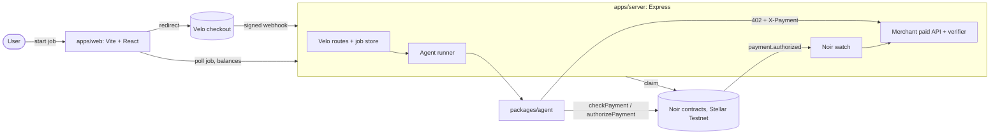

# Tollbooth

An AI agent that buys data one API call at a time and pays for each call itself on Stellar Testnet, inside a card spending limit it cannot exceed.

**Live website:** _to fill after deploy: https://&lt;your-app&gt;.vercel.app_

**Demo video (2 min):** _to fill: link_

**Team:** _to fill: names and roles_

## Problem

Paid APIs are built for humans with API keys and monthly invoices. An AI agent that needs one data point has two bad options. It can carry a human's full credentials, which means unlimited spending power, or it can stop and ask a person to pay. Neither lets an agent buy what it needs, when it needs it, with limits the owner actually controls.

## Solution

Tollbooth gives the agent a constrained key on a Noir card. The owner sets the policy once: which key may spend, which asset, a cap per payment (1 XLM) and an expiry, all backed by an escrow. The merchant API answers every unpaid request with `402 Payment Required` and a price. The agent then decides on its own whether the call is worth buying, checks the card's policy, pays, and retries with proof. A person pays only the flat job fee, through a Velo checkout. Every data purchase after that is the agent's own decision.

The demo job always tries the 2 XLM deep report, which is above the card's 1 XLM cap, so you can watch the card refuse the agent.

## How the agentic payment works

1. **A human pays for the job, not the data.** `POST /api/jobs` creates a Velo checkout session for a 1 XLM job fee. When Velo's signed `payment.succeeded` webhook arrives, the server starts the agent. No human click ever triggers a Noir payment.
2. **The agent plans.** It turns the topic into a list of candidate calls, each with an estimated value ([plan.ts](packages/agent/src/plan.ts#L12)).
3. **Each call starts with a 402.** The merchant answers `{ quoteId, price, asset, merchant, network, expiresAt }`. The quote is random, single use and valid for 2 minutes ([merchant.ts](apps/server/src/merchant.ts#L20)).
4. **The agent decides.** It skips calls that are over the remaining budget or worth less than their price ([decide.ts](packages/agent/src/decide.ts#L5)). Otherwise it asks Noir `checkPayment`. If the card would refuse (`over_limit`, `expired`, `insufficient_escrow`, ...), it logs the reason and does not pay.
5. **The agent pays with its own key.** It calls `authorizePayment` with `keypairSigner(AGENT_SECRET)` and retries the request with `X-Payment: <tx hash>` and `X-Quote-Id`.
6. **The merchant verifies through Noir.** The server watches `payment.authorized` events through the Noir SDK. It accepts a proof only if the merchant is ours, the device matches, the amount is at least the quoted price, the event came from the payment_escrow contract, and both the tx hash and the quote are unused and unexpired ([verifier.ts](apps/server/src/verifier.ts#L22)).
7. **Every decision is shown.** The job page prints the agent's trace as a receipt with stellar.expert links, and the merchant can claim its earnings.

All amounts are `bigint` stroops, converted only with the SDK's `toStroops` and `fromStroops`.

## Architecture



There's a sequence diagram of one paid call in [docs/architecture.md](docs/architecture.md).

## Noir integration

- **SDK:** `@noirx402/agent-sdk` 0.3.0, constructed as `new NoirAgentClient()` with no overrides.
- **Contracts:** the deployed 2026-10-24 Testnet contracts, which are the SDK's built-in defaults. The server and every script assert this at startup ([contracts.ts](packages/shared/src/contracts.ts#L10), [index.ts](apps/server/src/index.ts#L29)).
  - device_registry `CAC4KOLHDLDYDWBOKXNKRN5KVHO56PLOIFXDLTBUWGVN6GVDEB7FQHU5`
  - agent_registry `CCMZDSPTLX7IIJWCYEUM5DJUHOSOYSTHGK777S2TXZWEMC5ZZGPJ3EBV`
  - payment_escrow `CC7EAW5FNJEDBS7THM5IT6XIOHO4AOYMLXT3KSZ3HWUIKEACTW7E5BFS`

| SDK call | Where |
|---|---|
| `execute` → `registerDevice` | [scripts/setup.ts:52](scripts/setup.ts#L52) |
| `execute` → `registerAgent` (XLM SAC, 1 XLM cap, 30-day expiry) | [scripts/setup.ts:65](scripts/setup.ts#L65) |
| `execute` → `fundEscrow` | [scripts/setup.ts:74](scripts/setup.ts#L74) |
| `checkPayment` | [packages/agent/src/run.ts:41](packages/agent/src/run.ts#L41) |
| `authorizePayment` | [packages/agent/src/run.ts:47](packages/agent/src/run.ts#L47) |
| `claim` | [apps/server/src/claim.ts:18](apps/server/src/claim.ts#L18), [scripts/claim.ts:15](scripts/claim.ts#L15) |
| `getEscrowToken` (startup asset check) | [apps/server/src/index.ts:30](apps/server/src/index.ts#L30) |
| `getPendingBalance`, `getEscrowBalance` | [apps/server/src/claim.ts:10](apps/server/src/claim.ts#L10) |
| `watch` (`payment.authorized`) | [apps/server/src/noirWatch.ts:6](apps/server/src/noirWatch.ts#L6) |

We use `watch`, so `startWebhookRelay` and `verifyWebhookSignature` aren't needed.

**SDK compatibility note.** SDK 0.3.0 throws away any RPC event without `inSuccessfulContractCall`. Stellar RPC v23 and later (Testnet runs v30) no longer send that field and only return events from successful calls. Without a fix, `watch`, `getEvents` and `startWebhookRelay` see nothing on Testnet today. [rpcShim.ts](apps/server/src/rpcShim.ts#L10) puts the flag back on the RPC response so the SDK's own decoder and `watch` work unchanged. Its test replays a real Testnet event to show both the bug and the fix ([rpcShim.test.ts](apps/server/src/rpcShim.test.ts#L1)).

## Velo integration

- **SDK:** `@carts1024/velo-sdk` pinned to exactly `0.1.0-alpha.4`, server side only.
- **Checkout:** `velo.checkout.sessions.create` for the 1 XLM job fee, with an idempotency key per job ([velo.ts:51](apps/server/src/velo.ts#L51)).
- **Status:** `velo.paymentIntents.retrieve`, used as a fallback when the webhook is late ([velo.ts:71](apps/server/src/velo.ts#L71)).
- **Webhooks:** `Velo.webhooks.verify` on the raw body. Bad signatures get a 400, and duplicates are dropped by `x-velo-delivery` and by event id ([velo.ts:84](apps/server/src/velo.ts#L84)). The client is constructed in [index.ts:34](apps/server/src/index.ts#L34).

## Testnet proof

Agent transactions from `npm run demo`:

- quote, 0.1 XLM: https://stellar.expert/explorer/testnet/tx/66eb0d70c9b9e808bac1091d536002ef64e77eba6d8bc5a86420d1d0721c4abb
- weather, 0.05 XLM: https://stellar.expert/explorer/testnet/tx/abc8ce3376c422d75934b8ed6ef0a29e5adb36670656ceb3fdad21ae601a4d28
- news, 0.2 XLM: https://stellar.expert/explorer/testnet/tx/88a984d118ef4ef29c239298665622131a60d2717daa48c4372864396be2b68b
- merchant claim: https://stellar.expert/explorer/testnet/tx/16bc39047c1bd2c1b0da4cdda0107ea737debd26e6192a455c4b6bc5d17608d7
- The report was refused by the card policy (`over_limit`), so no transaction exists for it.

Card setup:

- registerDevice: https://stellar.expert/explorer/testnet/tx/3815d6413d3be7c49db9a11f92212c5ad1c49e50071cccbbf44d82b10d7d7b8c
- registerAgent: https://stellar.expert/explorer/testnet/tx/bb89266fe7e566a35e84f120434a9d38ddeeef571083f52b2f4dd0dda6e57e18
- fundEscrow: https://stellar.expert/explorer/testnet/tx/633ce0b13008c537086cd8b1b460772cd71d60bdba8d0b99b42d855d717d7007
- agent account: https://stellar.expert/explorer/testnet/account/GDH3XMBBEGNPBDSYU3GDUVV432P3PTY6GVQBSCKBKYVMVZHCHP47T2A5

## Repo structure

```
apps/web/        Vite + React site: start a job, watch the agent, claim
apps/server/     Express: merchant paid API, Velo checkout + webhook, Noir watch, agent runner
packages/agent/  plan, decide, paidFetch, runAgent (all Noir payment calls)
packages/shared/ prices, contract IDs + assertion, XLM SAC, types, env reader
scripts/         setup.ts (rebuild Testnet state), claim.ts, demo.ts
docs/            architecture, screenshots, design spec and plan
```

## Run it locally

You need Node 24.22.1 or newer (`.nvmrc`). The Noir SDK refuses older versions.

```bash
npm install
npm run setup        # creates and funds 3 Testnet accounts, registers the card, funds escrow; writes .env
npm test             # 50 unit tests
npm run demo         # one agent job end to end on Testnet, then claim; prints every link
npm run dev:server   # API on :8787 (needs VELO_* and WEB_ORIGIN in .env)
npm run dev:web      # site on :5173 (set VITE_API_URL=http://localhost:8787)
```

`npm run setup` is idempotent. Rerun it after a Testnet reset. To try the site locally without a Velo checkout, set `DEV_ROUTES=1` in `.env` and start a job with `curl -X POST localhost:8787/api/dev/jobs -H 'content-type: application/json' -d '{"topic":"stellar weather","budget":"2.5"}'`. Jobs run one at a time because they all pay with the same agent key.

## Environment variables

| Name | What it is | Where to get it |
|---|---|---|
| `OWNER_SECRET` | Card owner's Testnet secret key | Written by `npm run setup` |
| `AGENT_SECRET` | The agent's constrained key (server only) | Written by `npm run setup` |
| `MERCHANT_SECRET` | Merchant account that receives and claims payments | Written by `npm run setup` |
| `DEVICE_UID` | Demo card UID (no NFC hardware) | Defaults to `TOLLBOOTH-DEMO-0001` |
| `DEVICE_HASH` | SHA-256 of `DEVICE_UID`, the card's Noir ID | Written by `npm run setup` |
| `VELO_API_KEY` | Velo API key (server only) | Velo dashboard |
| `VELO_WEBHOOK_SECRET` | Velo webhook signing secret (server only) | Velo dashboard, webhook settings |
| `WEB_ORIGIN` | Public URL of the site (CORS, checkout return URLs) | Your Vercel URL |
| `PUBLIC_SERVER_URL` | Public URL of the API | Your Render URL |
| `VITE_API_URL` | API URL baked into the site at build time | Your Render URL |
| `DEV_ROUTES` | `1` turns on `POST /api/dev/jobs`, which starts a job without a Velo checkout. Local only. Never set it on Render, because anyone could spend the card's escrow | Set it yourself in your local `.env` |
| `NODE_ENV` | Set to `production` on Render so error responses don't include stack traces | Render environment settings |
| `AGENT_LLM` | Reserved for an optional LLM planner (unused; rules run by default) | Leave empty |
| `ANTHROPIC_API_KEY` | Reserved for the optional planner | Leave empty |

## Screenshots

Start page: the lane board shows each call's price against the card's 1 XLM limit.


A finished job, started locally with the dev trigger: the report refused by the card, three paid calls with Testnet links, and the agent's receipt.


## What's next

- An LLM planner behind `AGENT_LLM=on` that estimates each call's value from the topic, with the same rules as a hard backstop.
- Several merchants competing on price for the same data.
- Persistent jobs, so a server restart doesn't clear them.
- Upstream the RPC v23+ event fix to `@noirx402/agent-sdk`.

## Credits

Built on [Noir](https://github.com/rylsherdamz-rgb/Noir_Wallet) (`@noirx402/agent-sdk`), Velo (`@carts1024/velo-sdk`) and Stellar Testnet. Payment pattern inspired by x402. Typeface: Overpass.
