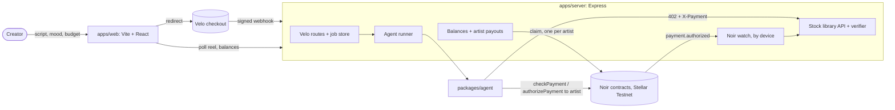
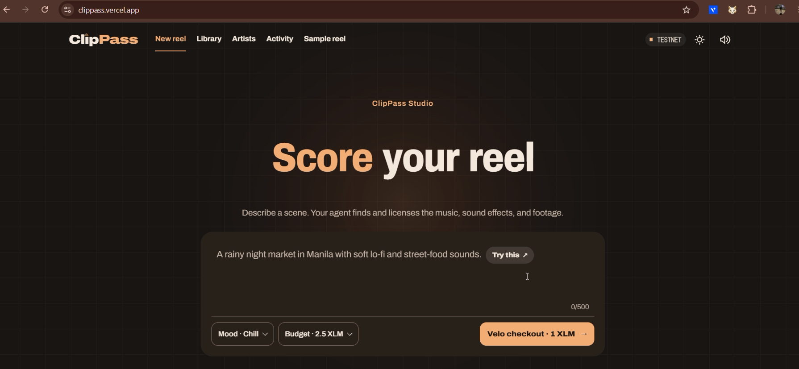
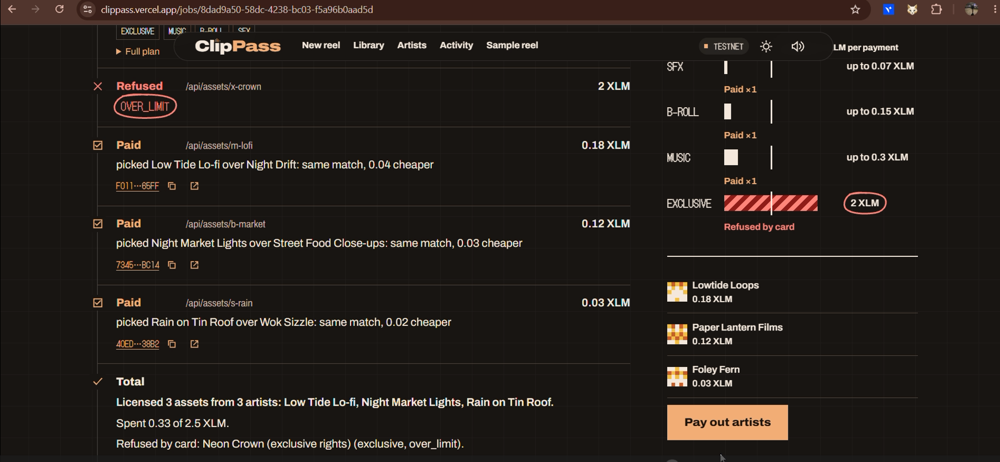

# ClipPass

An AI agent that licenses stock media for each reel. A creator describes the reel and sets a budget. The agent picks the background music, b-roll and sound effects, then pays each artist per use on Stellar Testnet, inside a card spending limit it cannot exceed. Every asset arrives with a license tied to a Stellar transaction.

**Live website:** _to fill after deploy: https://&lt;your-app&gt;.vercel.app_

**Demo video (2 min):** _to fill: link_

**Team:** _to fill: names and roles_

## Problem

- **Creators overpay.** Stock music and footage are sold as monthly subscriptions, but many short-form creators need only two or three assets a month.
- **Copyright claims hurt.** Reels get muted or demonetized over music claims, and a creator rarely has clean proof of what they paid for and when.
- **Small artists get paid last.** Musicians and videographers earn tiny pooled royalties instead of being paid for each use.

## Solution

ClipPass gives an agent a constrained key on a Noir card. The owner sets the policy once: which key may spend, which asset, a cap per payment (1 XLM) and an expiry, all backed by an escrow. The creator pays a flat 1 XLM reel project fee through a Velo checkout, then the agent does the rest. It reads the script, plans one music track, three b-roll clips and two sound effects, and buys each one from a stock library that answers `402 Payment Required` with that asset's price. Each payment goes straight to the artist's own Stellar account, and the transaction is the license receipt.

Every reel also tries a 2 XLM exclusive-rights track. That is above the card's 1 XLM cap, so you can watch the card refuse the agent.

## Pitch

"This reel uses 6 assets from 4 artists. Here is the payment proof for every one. The agent tried an exclusive track and the card said no."

## How the agentic payment works

1. **A human pays for the project, not the media.** `POST /api/jobs` checks the script (1 to 500 characters), the mood and the budget, then creates a Velo checkout session for the 1 XLM fee. When Velo's signed `payment.succeeded` webhook arrives, the server starts the agent. No human click ever triggers a Noir payment.
2. **The agent plans the reel.** It turns the script and mood into seven slots: the exclusive first, then music, three b-roll and two SFX. Script words are matched to each lane's tags, so "rainy" matches `rain` ([plan.ts](packages/agent/src/plan.ts#L13)). With `AGENT_LLM` set, a local Ollama model reads the script and picks one tag per slot, limited to each lane's tag list ([llm.ts](packages/agent/src/llm.ts#L11)). The exclusive slot is never sent to the model, so the card refusal always shows.
3. **The agent picks the cheapest match.** For each slot it ranks the unused assets by matching tags, then by price, and writes down why: "picked Wok Sizzle over Market Crowd: same match, 0.02 cheaper". It never licenses the same asset twice in one reel ([pick.ts](packages/agent/src/pick.ts#L6)).
4. **Each asset starts with a 402.** `GET /api/assets/:id` answers `{ quoteId, price, asset, merchant, network, expiresAt }`, where `merchant` is that artist's address. The quote is random, single use and valid for 2 minutes ([merchant.ts](apps/server/src/merchant.ts#L11)).
5. **The agent decides.** It skips anything over the remaining budget, or quoted above the catalog's listed price ([decide.ts](packages/agent/src/decide.ts#L5)). Otherwise it asks Noir `checkPayment`. If the card would refuse (`over_limit`, `expired`, `insufficient_escrow`, ...), it logs the reason and does not pay.
6. **The agent pays the artist with its own key.** It calls `authorizePayment` to the artist's address with `keypairSigner(AGENT_SECRET)` and retries the request with `X-Payment: <tx hash>` and `X-Quote-Id` ([run.ts](packages/agent/src/run.ts#L59)).
7. **The library verifies through Noir.** The server watches `payment.authorized` events for our device. It accepts a proof only if the payment went to the artist named on the quote, the device matches, the amount is at least the quoted price, the event came from the payment_escrow contract, and both the tx hash and the quote are unused and unexpired ([verifier.ts](apps/server/src/verifier.ts#L32)). Then it returns the license.
8. **Artists collect.** "Pay out artists" claims each artist's pending balance with that artist's own key ([claim.ts](apps/server/src/claim.ts#L8)). The job page shows the license sheet (asset, artist, price, tx link) and every decision the agent made.

All amounts are `bigint` stroops, converted only with the SDK's `toStroops` and `fromStroops`. Media is mocked by design. The catalog is 14 assets from 4 fictional studios ([catalog.ts](packages/shared/src/catalog.ts#L20)), and preview and download links use the reserved `clippass.example` domain. The payments are real Testnet payments.

## Architecture



There's a sequence diagram of one licensed asset in [docs/architecture.md](docs/architecture.md).

## Noir integration

- **SDK:** `@noirx402/agent-sdk` 0.3.0, constructed as `new NoirAgentClient()` with no overrides.
- **Contracts:** the deployed 2026-10-24 Testnet contracts, which are the SDK's built-in defaults. The server and every script assert this at startup ([contracts.ts](packages/shared/src/contracts.ts#L10), [index.ts](apps/server/src/index.ts#L31)).
  - device_registry `CAC4KOLHDLDYDWBOKXNKRN5KVHO56PLOIFXDLTBUWGVN6GVDEB7FQHU5`
  - agent_registry `CCMZDSPTLX7IIJWCYEUM5DJUHOSOYSTHGK777S2TXZWEMC5ZZGPJ3EBV`
  - payment_escrow `CC7EAW5FNJEDBS7THM5IT6XIOHO4AOYMLXT3KSZ3HWUIKEACTW7E5BFS`

| SDK call | Where |
|---|---|
| `execute` → `registerDevice` | [scripts/setup.ts:54](scripts/setup.ts#L54) |
| `execute` → `registerAgent` (XLM SAC, 1 XLM cap, 30-day expiry) | [scripts/setup.ts:67](scripts/setup.ts#L67) |
| `execute` → `fundEscrow` | [scripts/setup.ts:76](scripts/setup.ts#L76) |
| `checkPayment` | [packages/agent/src/run.ts:53](packages/agent/src/run.ts#L53) |
| `authorizePayment` (payee = the quote's artist) | [packages/agent/src/run.ts:59](packages/agent/src/run.ts#L59) |
| `claim` (one per artist, signed by that artist) | [apps/server/src/claim.ts:17](apps/server/src/claim.ts#L17), used by [scripts/claim.ts:13](scripts/claim.ts#L13) and `scripts/demo.ts` |
| `getEscrowToken` (startup asset check) | [apps/server/src/index.ts:32](apps/server/src/index.ts#L32) |
| `getPendingBalance`, `getEscrowBalance` | [apps/server/src/claim.ts:31](apps/server/src/claim.ts#L31) |
| `watch` (`payment.authorized`, filtered by `deviceHash`) | [apps/server/src/noirWatch.ts:6](apps/server/src/noirWatch.ts#L6) |

We use `watch`, so `startWebhookRelay` and `verifyWebhookSignature` aren't needed.

**SDK compatibility note.** SDK 0.3.0 throws away any RPC event without `inSuccessfulContractCall`. Stellar RPC v23 and later (Testnet runs v30) no longer send that field and only return events from successful calls. Without a fix, `watch`, `getEvents` and `startWebhookRelay` see nothing on Testnet today. [rpcShim.ts](apps/server/src/rpcShim.ts#L10) puts the flag back on the RPC response so the SDK's own decoder and `watch` work unchanged. Its test replays a real Testnet event to show both the bug and the fix ([rpcShim.test.ts](apps/server/src/rpcShim.test.ts#L1)).

## Velo integration

- **SDK:** `@carts1024/velo-sdk` pinned to exactly `0.1.0-alpha.4`, server side only.
- **Checkout:** `velo.checkout.sessions.create` for the 1 XLM reel project fee, with an idempotency key per reel ([velo.ts:53](apps/server/src/velo.ts#L53)).
- **Status:** `velo.paymentIntents.retrieve`, used as a fallback when the webhook is late ([velo.ts:73](apps/server/src/velo.ts#L73)).
- **Webhooks:** `Velo.webhooks.verify` on the raw body. Bad signatures get a 400, and duplicates are dropped by `x-velo-delivery` and by event id ([velo.ts:86](apps/server/src/velo.ts#L86)). The client is constructed in [index.ts:36](apps/server/src/index.ts#L36).

## Testnet proof

One reel from `npm run demo` (script "Rain at a night market in Manila, street food sizzle, crowd chatter", mood chill, budget 2.5 XLM). This run had `AGENT_LLM=qwen2.5:3b-instruct`, so the model tagged the slots. With rules only, the same reel licenses Market Crowd in place of Rain on Tin Roof and spends 0.67 XLM.

License sheet, 6 assets from 4 artists, 0.63 XLM:

| Asset | Artist | Price | License tx |
|---|---|---|---|
| Low Tide Lo-fi (music) | Lowtide Loops | 0.18 XLM | [30f92754…](https://stellar.expert/explorer/testnet/tx/30f927544cf0d4bab369d1ad8f6210e9a24da0ccda39d297bc47acb48dfda5b1) |
| Rain on Glass (b-roll) | Paper Lantern Films | 0.10 XLM | [ef7c8d3a…](https://stellar.expert/explorer/testnet/tx/ef7c8d3ac60d234297f5787a0bb82da4021afa7dc3cba5642fa60a25ac201836) |
| Night Market Lights (b-roll) | Paper Lantern Films | 0.12 XLM | [5e22b03d…](https://stellar.expert/explorer/testnet/tx/5e22b03d5f1f8d8a6e0ad266df82f515805e96691fadce44758c3738a95781a1) |
| Street Food Close-ups (b-roll) | Kestrel Studio | 0.15 XLM | [a00a7b5b…](https://stellar.expert/explorer/testnet/tx/a00a7b5b2cdbe3116fda8d9beaa85f7ab5cd40f571b769033c038690a3b2de32) |
| Rain on Tin Roof (SFX) | Foley Fern | 0.03 XLM | [99d4995a…](https://stellar.expert/explorer/testnet/tx/99d4995a8624cdf9218690aaa58e981dc7dba2bbcd98fcdb517bcf81b3f6aaa2) |
| Wok Sizzle (SFX) | Foley Fern | 0.05 XLM | [950dbd8c…](https://stellar.expert/explorer/testnet/tx/950dbd8cad6f4414129bde098a45be971fb45675ce09e07efaa2bdea90aa7e58) |

Neon Crown (exclusive rights, 2 XLM) was refused by the card policy (`over_limit`), so no transaction exists for it.

Artist payouts, each signed by the artist's own key:

- Lowtide Loops, 0.18 XLM: https://stellar.expert/explorer/testnet/tx/a238e4c9b0d42fdc41e97abcf025c3cf1008537495119783e67b21706069d2ff
- Paper Lantern Films, 0.22 XLM: https://stellar.expert/explorer/testnet/tx/bec18e2bdfe884d4ebc829e5ecdb6708c93561319e662ef9e8e3bbb5d3d72a6f
- Kestrel Studio, 0.15 XLM: https://stellar.expert/explorer/testnet/tx/92ed0458cc7ad17d63413daffd5fc3737fedd6049339878a138b78d5e5d94bdd
- Foley Fern, 0.08 XLM: https://stellar.expert/explorer/testnet/tx/045cfcfb2dfca52d1fc66a1940bc0fa3ac37957baa8f29cd65524c0c6a0e541d

Artist accounts:

- Lowtide Loops: https://stellar.expert/explorer/testnet/account/GBLSA47JDN23GF6TGNQQLNOAQOWU7Y43EXGHNLPZY6MALYTCNLK2BQVK
- Paper Lantern Films: https://stellar.expert/explorer/testnet/account/GAGVLOURGZCBDHWT25URFH5J425LXMSCK5XZDW3P6UY64Z5BV4W3PC4C
- Kestrel Studio: https://stellar.expert/explorer/testnet/account/GA6ZWR7MMMXYRXO7YVFOZP4Z7BUM4ILLZFUGLFQDJEJGRXTWZTTQR4TA
- Foley Fern: https://stellar.expert/explorer/testnet/account/GB6VFK2RH5SKE4W4TBU5YM2UAARLUR676XOJ22LL3X5ITH4KSBVZFHLI

Card setup:

- registerDevice: https://stellar.expert/explorer/testnet/tx/3815d6413d3be7c49db9a11f92212c5ad1c49e50071cccbbf44d82b10d7d7b8c
- registerAgent: https://stellar.expert/explorer/testnet/tx/bb89266fe7e566a35e84f120434a9d38ddeeef571083f52b2f4dd0dda6e57e18
- fundEscrow: https://stellar.expert/explorer/testnet/tx/633ce0b13008c537086cd8b1b460772cd71d60bdba8d0b99b42d855d717d7007
- agent account: https://stellar.expert/explorer/testnet/account/GDH3XMBBEGNPBDSYU3GDUVV432P3PTY6GVQBSCKBKYVMVZHCHP47T2A5

## Repo structure

```
apps/web/        Vite + React site: describe a reel, watch the agent, license sheet, pay out artists
apps/server/     Express: stock library 402 API, Velo checkout + webhook, Noir watch, agent runner, artist payouts
packages/agent/  plan, pick, decide, paidFetch, runAgent (all Noir payment calls), optional Ollama planner
packages/shared/ asset catalog, artists, moods, contract IDs + assertion, XLM SAC, types, env reader
scripts/         setup.ts (rebuild Testnet state), claim.ts (pay out artists), demo.ts
docs/            architecture, screenshots, design specs and plans
```

## Run it locally

You need Node 24.22.1 or newer (`.nvmrc`). The Noir SDK refuses older versions.

```bash
npm install
npm run setup        # creates and funds the owner, agent and 4 artist accounts, registers the card, funds escrow; writes .env
npm test             # 71 unit tests
npm run demo         # one reel end to end on Testnet, then artist payouts; prints every link
npm run claim        # pay out every artist with pending earnings
npm run dev:server   # API on :8787 (needs VELO_* and WEB_ORIGIN in .env)
npm run dev:web      # site on :5173 (set VITE_API_URL=http://localhost:8787)
```

`npm run setup` is idempotent. Rerun it after a Testnet reset. To try the site locally without a Velo checkout, set `DEV_ROUTES=1` in `.env` and start a reel with `curl -X POST localhost:8787/api/dev/jobs -H 'content-type: application/json' -d '{"mood":"chill","budget":"2.5"}'` (the script defaults to the demo script). Reels run one at a time because they all pay with the same agent key.

## Environment variables

| Name | What it is | Where to get it |
|---|---|---|
| `OWNER_SECRET` | Card owner's Testnet secret key | Written by `npm run setup` |
| `AGENT_SECRET` | The agent's constrained key (server only) | Written by `npm run setup` |
| `ARTIST_LOWTIDE_SECRET`, `ARTIST_LANTERN_SECRET`, `ARTIST_KESTREL_SECRET`, `ARTIST_FERN_SECRET` | Each artist's account, which receives license payments and claims them (server only) | Written by `npm run setup` |
| `DEVICE_UID` | Demo card UID (no NFC hardware) | Defaults to `TOLLBOOTH-DEMO-0001` |
| `DEVICE_HASH` | SHA-256 of `DEVICE_UID`, the card's Noir ID | Written by `npm run setup` |
| `VELO_API_KEY` | Velo API key (server only) | Velo dashboard |
| `VELO_WEBHOOK_SECRET` | Velo webhook signing secret (server only) | Velo dashboard, webhook settings |
| `WEB_ORIGIN` | Public URL of the site (CORS, checkout return URLs) | Your Vercel URL |
| `PUBLIC_SERVER_URL` | Public URL of the API | Your Render URL |
| `VITE_API_URL` | API URL baked into the site at build time | Your Render URL |
| `DEV_ROUTES` | `1` turns on `POST /api/dev/jobs`, which starts a reel without a Velo checkout. Local only. Never set it on Render, because anyone could spend the card's escrow | Set it yourself in your local `.env` |
| `NODE_ENV` | Set to `production` on Render so error responses don't include stack traces | Render environment settings |
| `AGENT_LLM` | Ollama model that reads the script and tags each slot (e.g. `qwen2.5:3b-instruct`). Empty: rules only. If Ollama is down, the agent falls back to the rules | `ollama pull qwen2.5:3b-instruct` |
| `OLLAMA_URL` | Ollama address | Defaults to `http://localhost:11434` |

**Deploying:** Render needs the four `ARTIST_*_SECRET` values. `MERCHANT_SECRET` is no longer used. Vercel only needs a rebuild.

## Screenshots

Start page: the lane board shows each lane's top price against the card's 1 XLM limit.



A finished reel, started locally with the dev trigger: the license sheet with Testnet links, the exclusive refused by the card, and the agent's decisions.



## What's next

- Real catalogs: let artists upload media and set their own per-use price.
- Several libraries competing on price for the same mood and scene.
- Persistent reels, so a server restart doesn't clear them.
- Upstream the RPC v23+ event fix to `@noirx402/agent-sdk`.

## Credits

Built on [Noir](https://github.com/rylsherdamz-rgb/Noir_Wallet) (`@noirx402/agent-sdk`), Velo (`@carts1024/velo-sdk`) and Stellar Testnet. Payment pattern inspired by x402. Typeface: Overpass. The repo began as Tollbooth, a pay-per-call data agent; the demo card's `DEVICE_UID` keeps that name on purpose, because changing it would register a new device and escrow.
